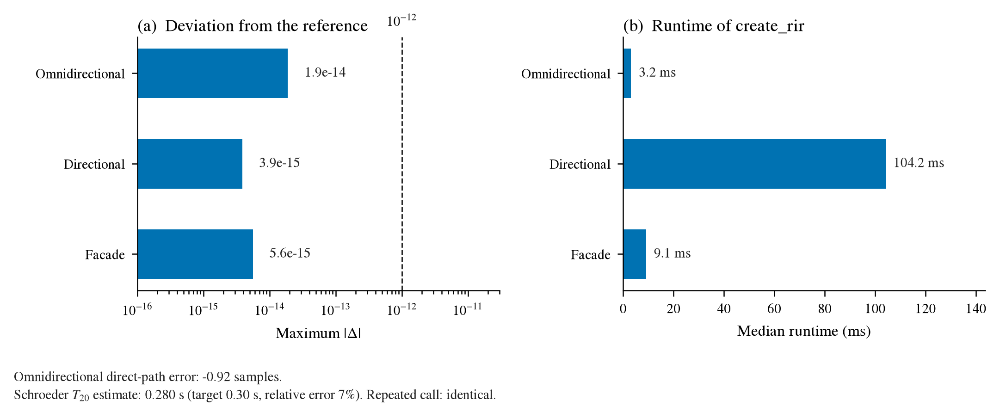
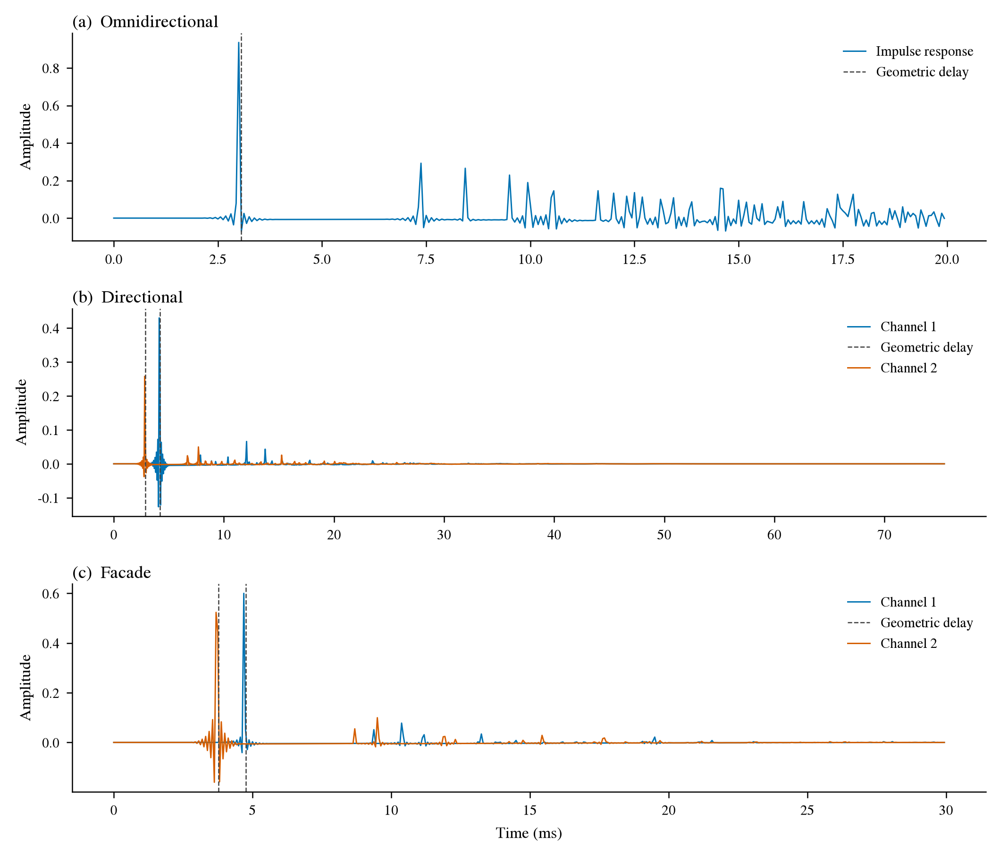
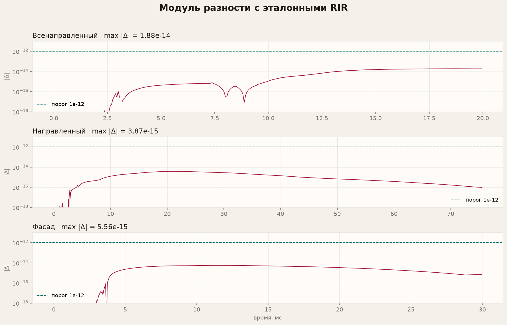
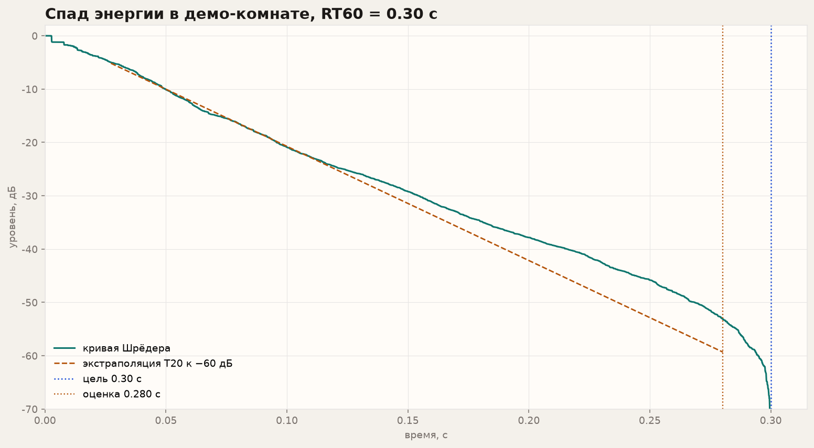
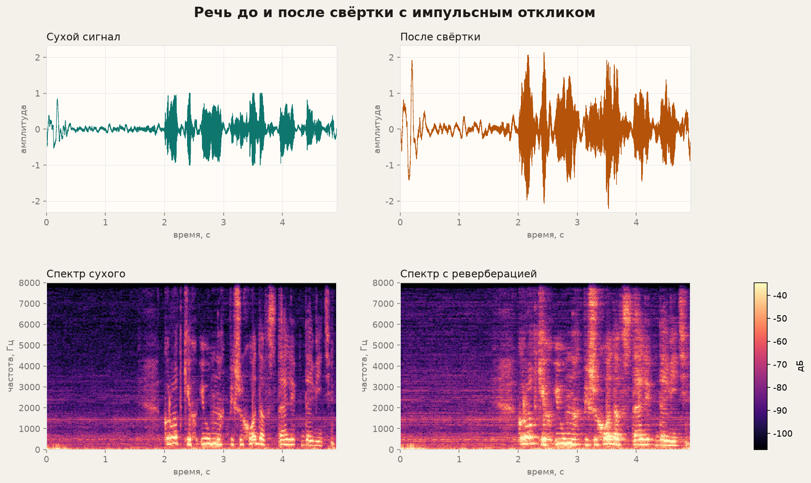

# Quality of PY_ROOMSIM

This report was written by `scripts/make_quality_report.py` on 2026-10-18 13:45 UTC. It compares three reference rooms in `tests/fixtures/`, the geometric direct-path delay, and an RT60 estimate from the Schroeder curve. Bit-exact agreement does not hold on this platform: the residual is in the last bits of the FFT and of `lfilter`, so the acceptance threshold is `1e-12`.

Run versions: Python 3.12.3, NumPy 2.5.4, SciPy 1.18.1, soundfile 0.14.0.

## Summary



| Check | Result |
| --- | --- |
| Maximum \|Δ\| across the reference rooms | 1.883e-14 |
| Repeated omnidirectional call | identical |
| Direct-path error | -0.92 samples (peak 48, geometry 48.92) |
| RT60, target 0.30 s | estimate 0.280 s, relative error 7% |
| Demo-room absorption | 0.2494 |

## Impulse responses

The dashed line is the delay `distance / 343`. The one-sample tolerance applies to the omnidirectional room.



## Deviation from the reference

| Room | max \|Δ\| | within 1e-12 |
| --- | --- | --- |
| Omnidirectional | 1.883e-14 | yes |
| Directional | 3.865e-15 | yes |
| Facade | 5.563e-15 | yes |



## Energy decay

The demo room is 3.5×4.0×2.5 m, with a target RT60 of 0.30 s and one omnidirectional microphone plus one cardioid. The slope is fitted on the Schroeder curve from −5 dB to −25 dB and extrapolated to −60 dB (T20). This is an order-of-magnitude check: the impulse is truncated at the length set by the target RT60, and air absorption in the simulator adds decay beyond the Norris–Eyring formula.



## Listening example

`wav/4.wav` is resampled to 16 kHz by `AudioLoader` and convolved with the first channel of the demo impulse response by `OverlapAddFilter`. The convolution has the same length as the dry signal. The files below are normalized to a peak of 0.98 for playback; the figure shows the waveform before normalization.

- [examples/rir_stereo.wav](examples/rir_stereo.wav) — stereo impulse response, raw peak 0.939
- [examples/speech_reverb.wav](examples/speech_reverb.wav) — reverberant speech, raw peak 2.211, dry peak 1.012



## Runtime

Median of three `create_rir` calls on the reference rooms.

| Room | median (ms) | samples |
| --- | --- | --- |
| Omnidirectional | 3.2 | 320 |
| Directional | 104.2 | 1208 |
| Facade | 9.1 | 480 |

## Reproduce

```bash
python3 -m pip install --user -r requirements-report.txt
python3 -m unittest tests.test_quality_metrics -v
python3 scripts/make_quality_report.py
```

The script overwrites this file and `img/quality/metrics.json`.
